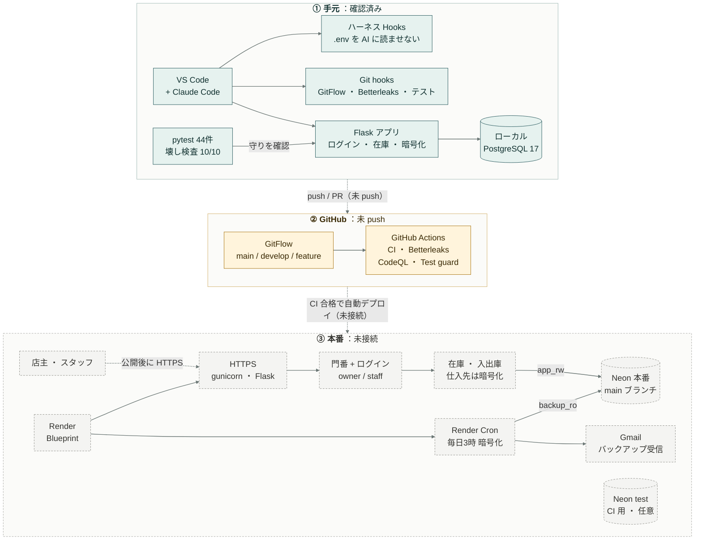
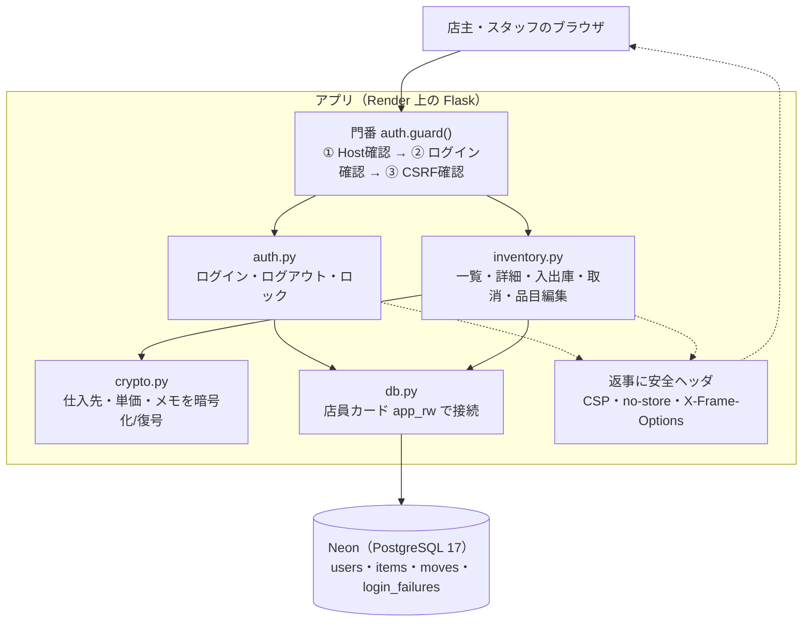

# 構成（喫茶店の在庫管理）

仕入先・原価などの秘匿性が高い情報を扱うので、**「漏らさない・混ぜない・消さない」** を各層で二重に守る構成にしています。

## いまの状態（2026-11-04 時点）

凡例: ✅ 手元で実行して確認済み / 📄 ファイルはできている・本番では未確認 / 👤 本人のアカウント作業待ち

| 場所                                                          | 状態  | 中身                                                                            | 残り                                        |
| ------------------------------------------------------------- | ----- | ------------------------------------------------------------------------------- | ------------------------------------------- |
| VS Code + Claude Code（ハーネス Hooks）                       | ✅    | `.claude/hooks/guard.py`（11パターンで確認）                                    | なし                                        |
| 秘密情報の分離                                                | ✅    | `.gitignore` `.env.example`（`.env` は手元だけ・chmod 600）                     | なし                                        |
| アプリ本体                                                    | ✅    | `app/`（ローカル Postgres 17 で起動し、ブラウザで店主/スタッフ/スマホ幅を確認） | なし                                        |
| テスト                                                        | ✅    | 44件 pass・壊し検査 10/10 RED                                                   | なし                                        |
| Git hooks（GitFlow・Betterleaks）                             | ✅    | `.githooks/`（使い捨てリポジトリで違反させて全部停止を確認）                    | なし                                        |
| Git のブランチ                                                | ✅    | `main` `develop` `feature/initial-setup`（ここにコミット済み）                  | **未 push**（⏸ 本人の OK 待ち）             |
| GitHub Actions（CI・CodeQL・Test guard・GitFlow・Dependabot） | 📄    | `.github/`                                                                      | push 後に初回実行を確認。ブランチ保護は 👤  |
| Render（CD・Web・Cron）                                       | 📄 👤 | `render.yaml` `backup/`                                                         | Blueprint 作成・環境変数の入力              |
| Neon（本番DB・テストDB・権限）                                | 📄 👤 | `docs/neon/roles.sql`（ローカル Postgres では確認済み）                         | プロジェクト作成・ロール作成・test ブランチ |
| Gmail（バックアップ受信）                                     | 📄 👤 | `backup/backup_db.py`（暗号化と復号はテスト済み）                               | アプリパスワード発行・実送信の確認          |

手順の続きは [SETUP.md](SETUP.md) の 3 から。

## 全体図

緑 = ローカルで実装・確認済み / 黄 = 設定ファイルあり・未実行 / 灰の点線枠 = 外部サービス未接続。図だけを大きく見たいときは [architecture-diagram.md](architecture-diagram.md) を VS Code で開いて `Cmd + Shift + V`。

## 層ごとの役割

| 層             | 道具                     | やること                                                                                                                  | 実体                                             |
| -------------- | ------------------------ | ------------------------------------------------------------------------------------------------------------------------- | ------------------------------------------------ |
| エディタ       | VS Code + Claude Code    | AI が `.env`・鍵ファイルを読む/書く、`--no-verify`、main/develop への直接 push を止める                                   | `.claude/settings.json` `.claude/hooks/guard.py` |
| 秘密情報の分離 | `.env` / `.env.example`  | 値は `.env`（gitignore・chmod 600）だけ。コードと Git には雛形だけ                                                        | `.gitignore` `.env.example`                      |
| テスト         | pytest + 壊し検査        | 44件。守り（CSRF・権限・暗号化など）を外すと落ちることを `mutation_check.py` で確認                                       | `tests/`                                         |
| Git            | Git hooks                | GitFlow 違反のコミット/push/マージを止める・Betterleaks でキー混入を止める・push 前にテスト                               | `.githooks/`                                     |
| GitHub         | Actions                  | CI（テスト）、Betterleaks（全履歴）、CodeQL（コード解析）、Test guard（テストの変更を感知）、GitFlow チェック、Dependabot | `.github/`                                       |
| Render         | Blueprint                | CD: main で CI が通ったら自動デプロイ。Cron でバックアップ                                                                | `render.yaml` `backup/`                          |
| Neon           | PostgreSQL 17            | 本番 = main ブランチ、テスト = test ブランチ（スキーマのみ）。ロールを最小権限で分ける                                    | `docs/neon/roles.sql` `app/schema.sql`           |
| Gmail          | SMTP（アプリパスワード） | 暗号化済みバックアップを毎日受け取る                                                                                      | `backup/backup_db.py`                            |

## アプリの中身（1回のアクセスで何が起きるか）

| ファイル                       | 役割                                                                 | 画面・コマンド                                                                                                                                           |
| ------------------------------ | -------------------------------------------------------------------- | -------------------------------------------------------------------------------------------------------------------------------------------------------- |
| `app/__init__.py`              | アプリの組み立て。鍵が足りなければ起動しない・安全ヘッダ・`/healthz` | `/healthz`（Render の死活確認）                                                                                                                          |
| `app/config.py`                | 設定。鍵は環境変数から読むだけ（ファイルに書かない）                 | ―                                                                                                                                                        |
| `app/auth.py`                  | 門番とログイン                                                       | `/login` `/logout`、`flask --app app auth set-user` / `disable-user`                                                                                     |
| `app/inventory.py`             | 在庫の画面と記録                                                     | `/` 一覧、`/items/<id>` 詳細、`/items/<id>/moves` 入出庫、`/moves/<id>/void` 取消（店主）、`/items/new` `/items/<id>/edit` `/items/<id>/archive`（店主） |
| `app/crypto.py`                | Fernet で暗号化/復号                                                 | ―                                                                                                                                                        |
| `app/db.py` `app/schema.sql`   | DB 接続と表の定義                                                    | `flask --app app init-db`                                                                                                                                |
| `app/templates/` `app/static/` | 画面（HTML・CSS）。外部読み込み・インライン JS なし                  | ―                                                                                                                                                        |

## アプリの守り（app/）

| 脅威                             | 対策                                                                                                  | 場所                       |
| -------------------------------- | ----------------------------------------------------------------------------------------------------- | -------------------------- |
| なりすまし                       | ログイン必須・scrypt ハッシュ・12文字以上・5回失敗で15分ロック・ID の有無を応答で漏らさない           | `auth.py`                  |
| 盗まれた Cookie                  | ログアウトで session_gen を進めて古い Cookie を無効化・HttpOnly / Secure / SameSite=Lax・12時間で失効 | `auth.py` `config.py`      |
| CSRF                             | 全 POST にトークン（ログインフォームも）                                                              | `auth.check_csrf`          |
| Host 偽装 / DNS リバインディング | `ALLOWED_HOSTS` 以外は 400                                                                            | `auth.check_host`          |
| XSS・クリックジャッキング        | 厳格な CSP（外部読み込み・インライン JS なし）・X-Frame-Options DENY                                  | `__init__.py`              |
| 共有端末・プロキシに残る         | 全ページ `Cache-Control: no-store`・`noindex`                                                         | `__init__.py` `base.html`  |
| DB 漏洩                          | 仕入先・単価・店主メモは Fernet（AES + HMAC）で暗号化して保存。鍵は Render の環境変数だけ             | `crypto.py` `inventory.py` |
| スタッフへの情報開示             | 役割 owner / staff。原価・仕入先・取消・品目編集は owner だけ                                         | `auth.owner_required`      |
| 記録の改ざん・消失               | 在庫は記録の合計。取消は削除せず印（誰がいつ）。DB ロールにも DELETE を与えない                       | `inventory.py` `roles.sql` |
| 弱い設定のまま本番起動           | SECRET_KEY / DATABASE_URL / APP_ENCRYPTION_KEY が無ければ起動しない                                   | `__init__.check_config`    |

## データ

- `users`（login_id・役割・パスワードハッシュ・session_gen・active）
- `items`（品名・区分・単位・発注点・届くまでの日数・**暗号化列** supplier_enc / unit_cost_enc / note_enc・archived）
- `moves`（入荷 in / 使用 out / 棚卸し count・増減・記録者・取消印）
- `login_failures`（ロック用）

在庫の状態は「在庫切れ → 要発注（発注点以下）→ まもなく（残り日数 ≦ 届くまでの日数）→ 十分」の順に並ぶ。1日の使用量は直近14日の平均。

## 鍵と接続文字列の置き場所

| 値                               | 置き場所                                                        | 作り方                                                                             |
| -------------------------------- | --------------------------------------------------------------- | ---------------------------------------------------------------------------------- |
| SECRET_KEY                       | Render が自動生成 / ローカルは `.env`                           | `python -c "import secrets;print(secrets.token_hex(32))"`                          |
| APP_ENCRYPTION_KEY               | Render 環境変数 + **パスワードマネージャに控え**                | `.venv/bin/python -c "from app.crypto import generate_key; print(generate_key())"` |
| BACKUP_ENCRYPTION_KEY            | Render Cron 環境変数 + **パスワードマネージャに控え**（別の鍵） | 同上                                                                               |
| DATABASE_URL（app_rw）           | Render 環境変数                                                 | Neon の接続文字列                                                                  |
| BACKUP_DATABASE_URL（backup_ro） | Render Cron 環境変数                                            | 同上                                                                               |
| GMAIL_APP_PASSWORD               | Render Cron 環境変数                                            | Google アカウント → アプリパスワード                                               |

> 暗号鍵を失うと、暗号化した列もバックアップも二度と読めません。必ず Render とは別の場所（パスワードマネージャ）に控えてください。
